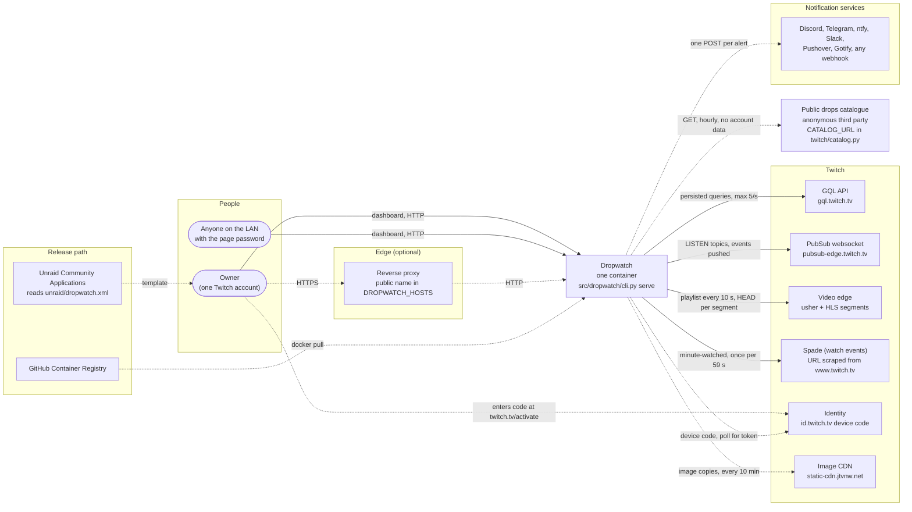
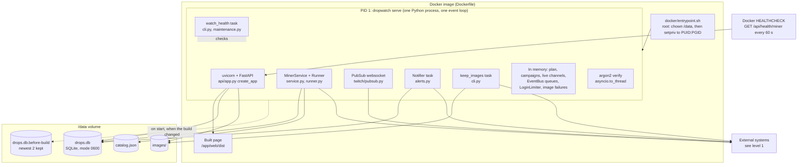
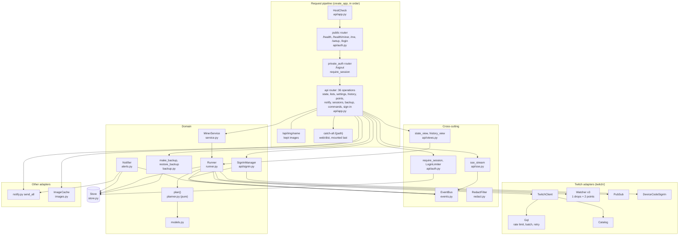

# C4 views

Read against `main` at `687d794` (2026-11-15).

Notation: [C4](https://c4model.com) levels drawn as Mermaid `flowchart`s, because Mermaid's own C4 diagrams
lay out poorly on GitHub. Each box names the file that owns it. Solid arrows are calls made on every
cycle; dotted arrows are optional or occasional.

## Level 1: system context

What the arrows mean:

- **Every Twitch call goes out from Dropwatch.** Nothing on the internet connects in. PubSub is the only
  push channel: Dropwatch opens the websocket (`twitch/pubsub.py`) and Twitch sends drop progress, claim
  ids, stream up and down, and channel-points events over it.
- **Watch credit comes from playback, not the heartbeat.** Since about 2026-10 Twitch counts minutes only
  while the account appears to play the stream, so `Watcher` (`twitch/watch.py`) re-reads the lowest
  quality playlist every 10 s and sends a `HEAD` for each new segment. No video is downloaded. The spade
  `minute-watched` POST still goes once per 59 s (`WATCH_INTERVAL`).
- **The catalogue is a runtime dependency people forget.** A TV-code session cannot list campaigns
  (`ViewerDropsDashboard` returns none), so discovery comes from a public catalogue run by an anonymous
  third party (`twitch/catalog.py`). It gets a plain `GET` from its own `AiohttpTransport` with no Twitch
  headers or cookies (`build_parts` in `service.py`). When it is down, campaigns already in the account's
  Inventory keep mining; new ones are not found.
- **Images come from one host only.** `ImageCache` (`images.py`) fetches only
  `https://static-cdn.jtvnw.net`, with no redirects and a 3 MB cap, so a stored URL cannot make Dropwatch
  reach anywhere else.
- **Notifications are one-way.** One HTTPS POST per alert per configured service (`notify.py`), 10 s
  budget, no retries except the weekly summary.
- **The release path is not a runtime dependency.** The container runs without GitHub once pulled. The
  page's "Dropwatch was updated" notice compares the build string in `/api/state` with the one the page
  loaded with; it never asks GitHub.

## Level 2: containers

Notes, each checked in code:

- **One process, one thread for the app.** The API handlers, the mining loop, PubSub, the notifier and
  the image keeper are asyncio tasks on one loop (`serve` in `cli.py`). The only other thread is argon2's
  `asyncio.to_thread` in `login` (`api/auth.py`). The `sqlite3` connection is opened on the loop thread
  and used only there.
- **One miner per container, and one container per Twitch account.** `MinerService` keeps at most one
  `Runner` (its `_lock`). Nothing stops a second container or a PC copy from using the same account; the
  README and [docker.md](../docker.md) tell people not to.
- **Restart instead of self-repair.** The Docker health check fails when the mining loop crashed or has
  not ticked for 15 minutes (`HEALTH_STALL`). Inside, `Watchdog` checks the same thing every 60 s and
  calls `os._exit(3)` after two bad checks, so the container's restart policy starts a fresh process.
  The watchdog runs only when `DROPWATCH_EXIT_WHEN_STUCK=1`, which the image sets.
- **What the image carries.** The Python package and its locked runtime dependencies (`uv sync --frozen
  --no-dev`), the built page, `tzdata` and `util-linux` (for `setpriv`). Not the browser sign-in extra,
  not `reference/`, `docs/`, `tests/` or `brand/` (`.dockerignore`).
- **What the image does not do.** It does not update itself, open a port other than 5800, or talk to
  GitHub. Updates are a new image pulled by Docker or Unraid.
- **Database mode.** SQLite in its default rollback-journal mode, one connection, no WAL setting. Every
  write commits at once (`with self._db:`).
- **Secrets at rest.** The Twitch token and notification secrets are plain text in `drops.db`, which is
  created `0600` (`Store.__init__`); so are the upgrade copies (`backup_on_upgrade`). The page password is
  an argon2 hash; page sessions are stored as sha256 hashes of their tokens.

## Level 3: components of the process

The api router's 36 operations are grouped into one box; `docs/api/openapi.json` lists each. With the 5
public routes, `/api/logout` and `/api/img/{name}` (left out of the schema) that is 43 routes
(`grep -cE "@(api|public|private_auth)\." src/dropwatch/api/*.py`).

What the component view shows that the directory map does not:

- **`HostCheck` runs before anything, health included.** A health probe has to use an IP address or
  `localhost`; the image's own probe uses `127.0.0.1`.
- **The public routes say almost nothing.** `/api/health/miner` returns only `{"ok": bool}` and logs the
  reason, because it answers without a session.
- **The catch-all is mounted last and refuses `api/`.** A mistyped API path gets a JSON 404, not
  `index.html`. It also refuses paths with `\` or `:` so a Windows install never opens a network path.
- **The runner is the only writer of mining state, and the API steers it through five commands:**
  `pause`, `resume`, `mine_now`, `use_channel`, `end_streak_visit`, plus `refresh` and `replan`. Settings
  and lists are written to the store by the API and take effect through `replan()` (no Twitch calls) or
  `refresh()` (`PLANNER_SETTINGS` in `api/app.py` says which settings).
- **Three `Watcher`s share one transport.** `build_parts` gives the drop channel one watcher and the
  Channel points list two (`POINTS_SLOTS`), each with its own playback state, all on one cookie jar. The
  catalogue has its own transport.
- **The page never reads the bus directly.** The bus is a "something changed" signal; the page re-reads
  `/api/state`, which `state_view` builds from the runner's memory and the store.
