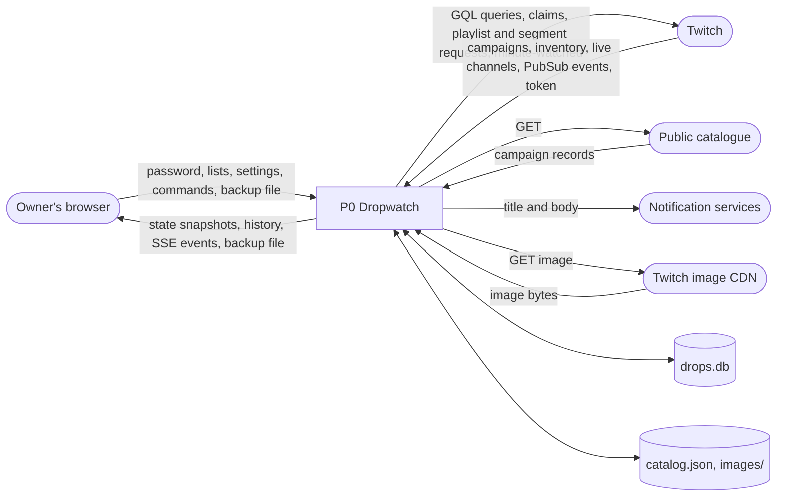
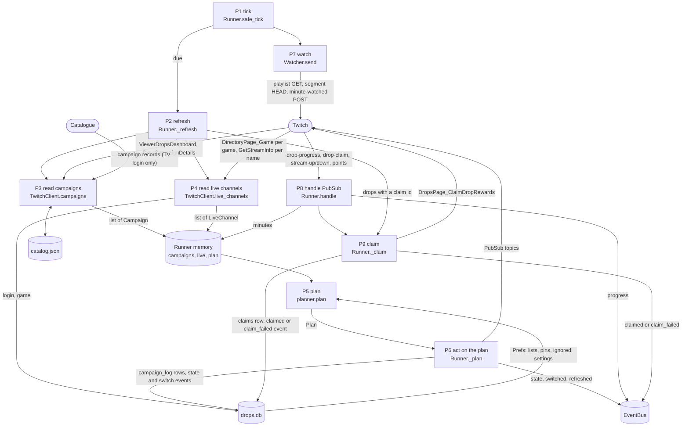
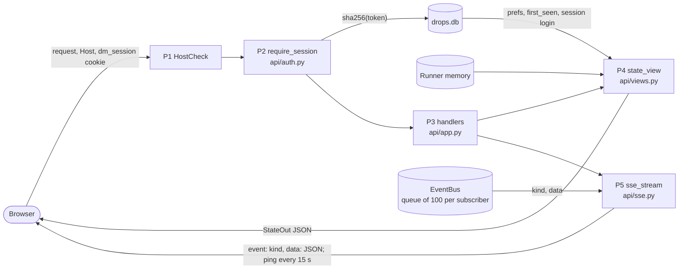
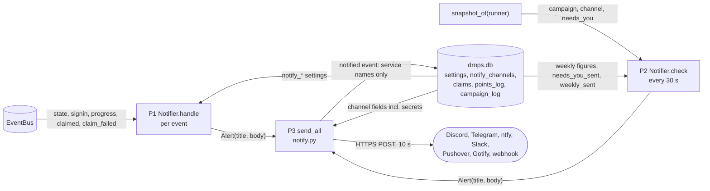
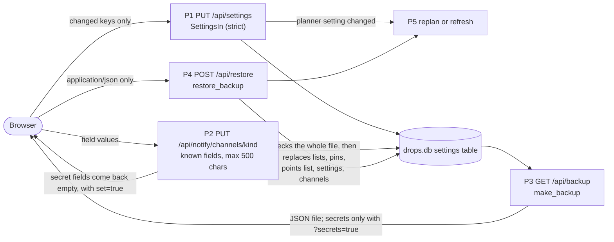
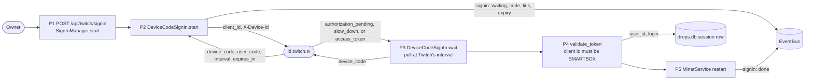

# Data flows

Read against `main` at `687d794` (2026-11-15).

Notation: rounded boxes `([...])` are external entities, rectangles are processes, cylinders `[(...)]` are
stores, and arrow labels name the data that moves.

## Level 0

## Level 1a: the mining cycle (the hot path)

Most of Dropwatch's traffic is this loop: a tick every 10 s, a refresh every 5 minutes, a campaign re-read
every hour by default.

| Step | In | Out | Where |
|---|---|---|---|
| P3 read campaigns | `Inventory` JSON, then either the dashboard list plus one `DropCampaignDetails` per campaign (batched 20 per POST) or the catalogue | `list[Campaign]`, with `linked` `True`/`False`/`None` and each drop's minutes, claim id and preconditions | `TwitchClient.campaigns`, `parse.to_campaign`, `parse.merge` (Inventory wins over the catalogue) |
| P4 read live channels | Campaigns that could be mined now, `Prefs` | `list[LiveChannel]` (`id, login, game_id, viewers, drops_enabled, broadcast_id, game_name`) | `TwitchClient.live_channels`: one directory query per game, then names only for channel-restricted campaigns the directory missed, favourites and the Channel points list |
| P5 plan | Campaigns, usable channels (not excluded), `Prefs`, `now`, overrides, current choice | `Plan(current, queue, needs_you, done, verdicts, also_credited, waiting, needs_ignored, outside)` | `planner.plan` |
| P6 act | `Plan`, previous channel | `watching`, points streams, PubSub topic set, state and switch events, `campaign_log` upserts | `Runner._plan`, `_log_campaigns` |
| P7 watch | `LiveChannel`, session | `True` when playback worked | `Watcher.send`: `PlaybackAccessToken` → usher master playlist → lowest media playlist → `HEAD` new segments; spade POST at most once per 59 s |
| P8 handle | PubSub frame | `DropProgress`, `DropClaimable`, `StreamUp`, `StreamDown`, `StreamChanged`, `PointsClaimable`, `PointsEarned` | `pubsub.parse_message`, `Runner.handle` |
| P9 claim | `claim_id` (Twitch's `dropInstanceID`) | `claims` row with rewards, minutes, channel, campaign size and end | `Runner._claim`; each claim id at most once per run (`_claimed`) |

Failure behaviour:

- `Gql` retries network errors, 429 and 5xx up to 3 times with back-off, then raises `TwitchUnreachable`.
  `refresh` catches it, sets `twitch_unreachable`, and retries after 60 s doubling to 600 s. The page shows
  the state; nothing already known is thrown away.
- A 401 from GQL raises `AuthExpired`. The runner goes `signed_out`, `MinerService._loop` deletes the
  session and publishes `signin` `expired`. The token is never retried.
- A channel whose playback fails 9 ticks in a row (about 90 s) or that sends `stream-down` is excluded for
  10 minutes (`EXCLUDE_FOR`), even if the directory still lists it.
- If Twitch never sends `drop-claim` for a drop at full minutes, campaigns are re-read at every refresh for
  up to an hour (`CLAIM_WAIT`), then the drop is left to the hourly read.
- A campaign whose link is unknown and that earns nothing for 10 minutes of good playback
  (`LINK_PROBE_TICKS`) is marked "may need linking" for up to 6 hours and moves to Needs you.
- Anything else a tick raises is logged, the state becomes `twitch_unreachable`, and the loop backs off.
  The loop itself never raises; if it dies anyway, `MinerService._loop_ended` records `crashed`, the
  health check fails, and the watchdog restarts the container.

## Level 1b: the page and live updates

The wire format is plain server-sent events: `event: <kind>` and a JSON `data:` line, a `: ping` comment
every 15 s, and nothing else. The page listens for 7 kinds (`EVENT_KINDS` in `web/src/api/live.ts`:
`state`, `refreshed`, `claimed`, `switched`, `needs_you`, `signin`, `progress`) and re-fetches `/api/state`
500 ms after the last one. The bus also carries `claim_failed`, which only the notifier uses. If the stream
stays broken for 15 s the page shows "Can't reach the miner"; it reconnects every 5 s and re-fetches on
reconnect. The permission check is `require_session` when the stream opens, then `session_alive` before
every event and ping, so a signed-out or expired browser's stream ends within 15 s.

## Level 1c: notifications

Each failure alert is sent once when it starts and once when it clears, and a recovery is only sent after
an alert that was actually sent (`Notifier._sent`). That memory is in process: a restart forgets which
alerts were out. "A campaign needs you" and the weekly summary keep what they sent in `settings`
(`notify_needs_you_sent`, `notify_weekly_sent`), so they survive a restart. Send errors carry the service
name and the HTTP status or exception type only, because a Telegram token is in the URL and a webhook URL
is itself the secret.

## Level 1d: saving settings, secrets and backups

Settings are stored as text (`"1"`/`"0"` for booleans) and typed on read by `Store.get_settings`. The API
never returns a secret field's value; it says whether it is set. A backup made without secrets restores
with the secrets already set on the install kept (`restore_backup`). A backup never carries the Twitch
session, the page password, sessions or History. `/api/restore` refuses anything but
`application/json`, so a plain cross-site form cannot post one.

## Level 1e: signing in to Twitch

Polling has no timeout of its own: Twitch's `expires_in` (about 30 minutes) or Cancel ends it. The token is
accepted only if `oauth2/validate` says it belongs to the TV client, because a token sent under another
client id earns no watch time.

## Key data structures

| Structure | Shape | Owner |
|---|---|---|
| Twitch session | `TwitchSession(access_token, user_id, login, device_id, client_id, session_id)`; one row in `session`, `CHECK (id = 1)` | `twitch/session.py`, `Store.get_session` |
| Prefs | `Prefs(priority, never, favourites, mine_badges, pins, ignored, priority_only, points_channels)`; `pins` empty unless `arrange_up_next`, `points_channels` empty unless `points_watch` | `models.py`, `Store.get_prefs` |
| Campaign | `Campaign(id, name, game, starts_at, ends_at, linked, link_url, allowed_logins, drops)`; `linked` is `None` when Twitch has not said | `models.py`, `parse.to_campaign` |
| Drop | `Drop(id, name, rewards, starts_at, ends_at, required_minutes, current_minutes, claimed, claim_id, preconditions)` | `models.py` |
| Plan | `Plan(current: Choice(campaign_id, channel_login, reason, channel_reason), queue, needs_you, done, verdicts, also_credited, waiting, needs_ignored, outside)` | `planner.py` |
| Error body | FastAPI's `{"detail": "<sentence>"}`, or `{"detail": [{"msg", ...}]}` for validation (422) | `api/app.py`; read by `call` in `web/src/api/client.ts` |
| Bus event | `(kind, data: dict)`; kinds `state`, `refreshed`, `switched`, `progress`, `claimed`, `claim_failed`, `needs_you`, `signin` | `events.py`, `Runner._emit`, `SignInManager._set`, `MinerService` |
| Logged event | `events(at, kind, data JSON)`, kept 7 days; 14 kinds, the fields shown per kind in `ACTIVITY_FIELDS` | `Store.log_event`, `api/app.py` |
| Claim | `claims(at, campaign_id, campaign, game, rewards JSON [{name, image_url}], minutes, channel, campaign_rewards, campaign_ends, box_art_url)`; older rows have `NULL` details | `Store.add_claim` |
| Campaign log | `campaign_log(id, name, game, box_art_url, link_url, ends_at, rewards JSON [{name, image_url, claimed}], first_seen, impossible_at_first, last_seen, linked, badge, never, priority, pinned, live, watched, outside)`, kept 400 days after the end | `Store.log_campaigns`; read by `missed_between` for History's 7 missed reasons |
| Points log | `points_log(at, channel, reason, points)`, kept 400 days | `Store.add_points` |
| Seen channels | `seen_channels(login, game, last_seen)`, kept 30 days | `Store.record_seen` (add-box suggestions) |
| Lists | `priority(position, game_name)`, `never(game_name)`, `favourites(position, channel_login)`, `points_channels(position, channel_login)` | `Store.set_lists`, `set_points_channels` |
| Page sessions | `web_sessions(token_hash, expires_at, created_at, last_seen_at, user_agent)`; the API's session id is the first 16 hex characters of the hash | `Store.create_web_session` |
| Typed settings | 20 keys in `SETTINGS`, stored as text in `settings`; in backups | `store.py`; listed in [configuration.md](../guides/configuration.md#settings-saved-in-the-app) |
| Other `settings` keys | `page_password_hash` (argon2, not in backups), `notify_channels` (JSON `{type: {field: value}}`, in backups, secrets only on request), `up_next_pins` and `needs_ignored` (JSON id lists, pins in backups, ignored not), `streak_done` (last 200 broadcast ids), `notify_needs_you_sent`, `notify_weekly_sent`, `last_build` (none of those four in backups) | `store.py`, `runner.py`, `alerts.py`, `maintenance.py` |
| Backup file | `{dropwatch_backup: 1, version, made_at, lists{priority, never, favourites}, pins, points_channels, settings, notify_channels}` | `backup.make_backup` |
| Catalogue cache | The catalogue's own response body, replaced atomically via `catalog.json.tmp` | `Catalog._save` |
| Kept image | `images/<first 24 hex of sha256(url)>.<ext>`, served at `/api/img/<name>` with a one-year immutable cache header | `ImageCache` |
| In-memory caches | `Watcher._media` and `_spade` (per login, until forgotten or a new broadcast), `Watcher._segments` (256 newest), `ImageCache._failed` (retry after 1 day, unbounded), `LoginLimiter._fails` (pruned past 1,000 addresses), `Notifier._sent` and `_failed_claims`, `Runner._claimed`, `_excluded`, `maybe_unlinked` | all lost on restart |
| Browser storage | `localStorage` `dw-theme` (theme) and the Activity filter (`SHOWN_KEY` in `Activity.tsx`) | `web/src/ui/theme.ts`, `web/src/views/Activity.tsx` |
