# User flows

Read against `main` at `687d794` (2026-11-15).

The journeys most people take, with the decision points and the success and error paths the code
actually has. Error texts and status codes are copied from the code so they can be searched for. Screen
and button names are the page's own.

## 1. First visit: protect the page

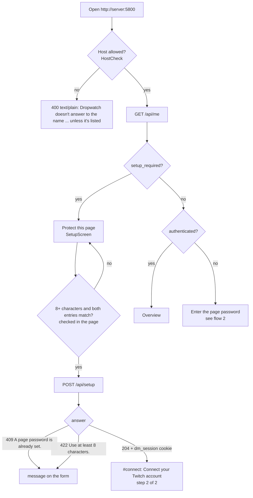

Divergence check: `SetupScreen` in `web/src/screens/PagePassword.tsx`, `setup` in
`src/dropwatch/api/auth.py`. `MIN_PASSWORD = 8` and `SESSION_TTL = 30 days` in `src/dropwatch/store.py`.
Setup is open to anyone who reaches the page until a password is set; `HostCheck` keeps a DNS-rebinding web
page from reaching it.

## 2. Later visits: sign in to the page

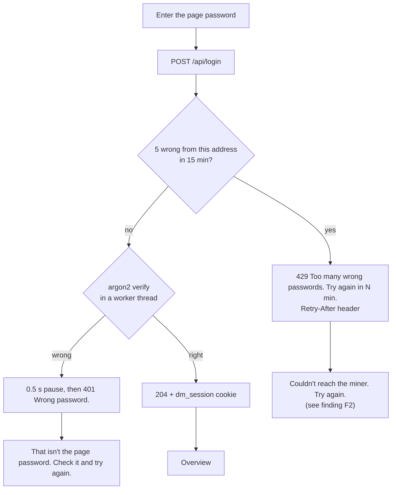

Divergence check: `login` and `LoginLimiter` in `src/dropwatch/api/auth.py` (`LOGIN_TRIES = 5`,
`LOGIN_WINDOW = 15 minutes`); `LoginScreen` in `web/src/screens/PagePassword.tsx`, which shows the
"Couldn't reach the miner" text for every status but 401, including the 429 lockout. The limiter counts
by `request.client.host`, which behind a reverse proxy is the proxy unless `FORWARDED_ALLOW_IPS` is set.

## 3. Connect a Twitch account

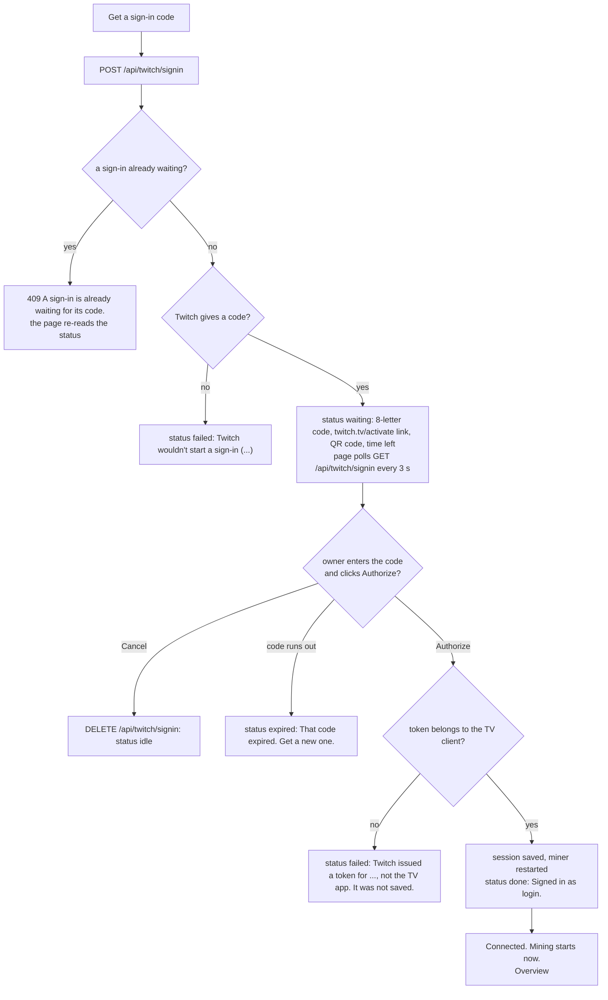

Divergence check: `ConnectScreen` in `web/src/screens/Connect.tsx` (`pollMs = 3000`), `SignInManager` in
`src/dropwatch/api/signin.py`, `DeviceCodeSignIn` and `validate_token` in `src/dropwatch/twitch/`. The code
lives as long as Twitch's `expires_in` (1,800 s when Twitch omits it).

## 4. The Overview screen

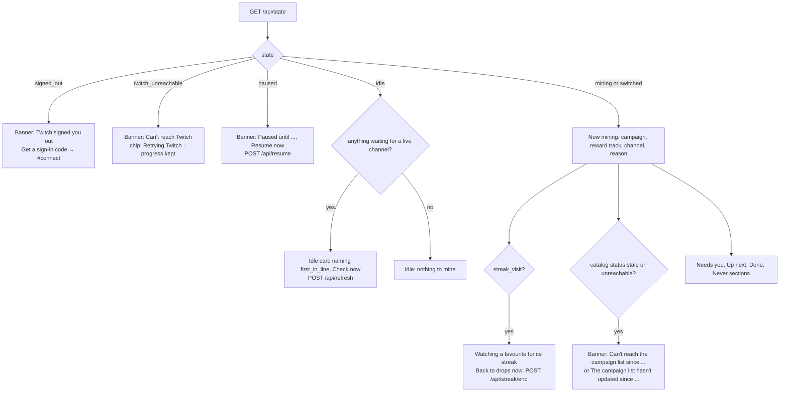

Divergence check: `OverviewView` in `web/src/views/Overview.tsx`, `state_view` in
`src/dropwatch/api/views.py`, `State` in `src/dropwatch/runner.py`. The top bar pill comes from `pillFor`
in `web/src/App.tsx`; when the event stream has been broken for 15 s it says "Miner unreachable" whatever
the last state was.

## 5. Steer the miner: Mine now, switch channel, pause

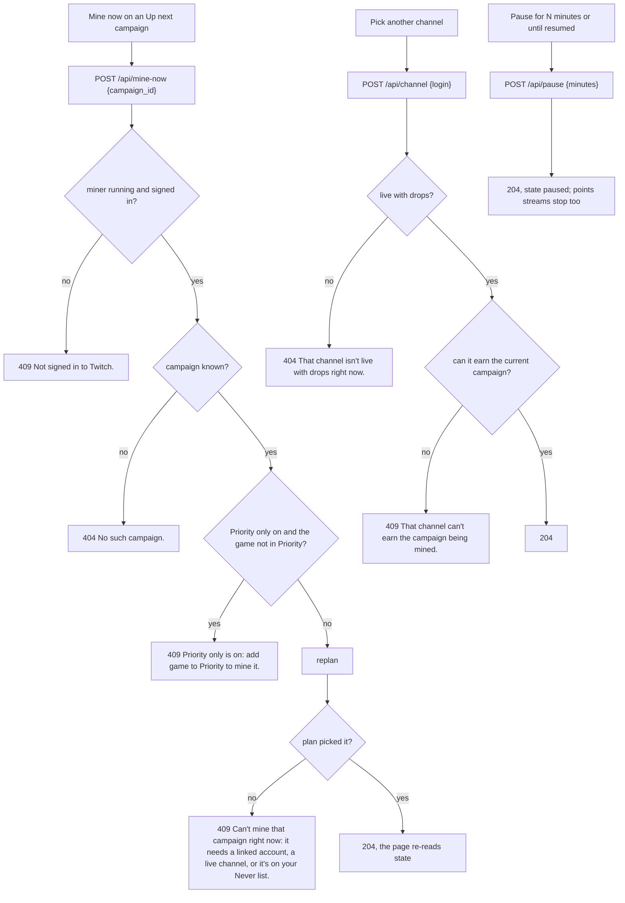

Divergence check: `mine_now`, `channel`, `pause` and `_runner` in `src/dropwatch/api/app.py`; overrides last
only while the plan still honours them (`Runner._plan`). A paused miner resumes by itself at `paused_until`
(`Runner.tick`).

## 6. Needs you: link an account, or ignore it

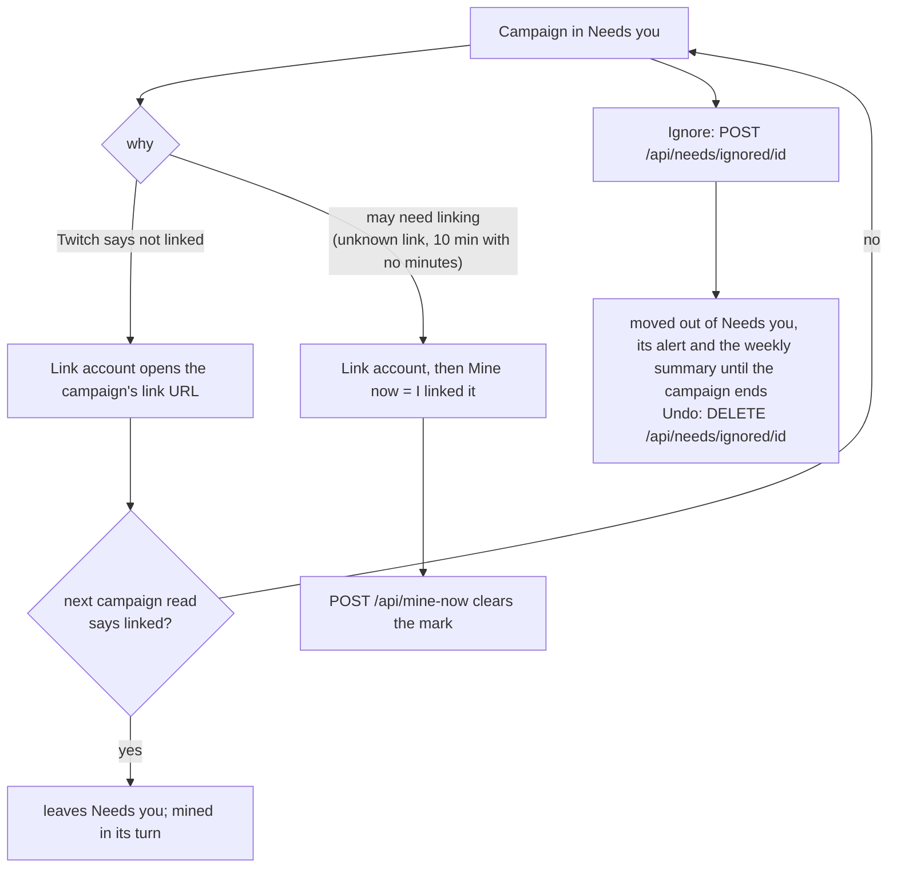

Divergence check: `plan()` in `src/dropwatch/planner.py` (`needs_you`, `needs_ignored`), `_probe_link`
and `_settle_link_marks` in `src/dropwatch/runner.py` (`LINK_PROBE_TICKS = 60`, `MAYBE_UNLINKED_FOR = 6
hours`), `ignore_needs` in `src/dropwatch/api/app.py` (keeps the newest 200 ids). Campaign reads follow
`campaigns_every_minutes`, or every 10 minutes while a link is being tested (`LINK_RECHECK`).

## 7. Change Priorities, Never and favourites

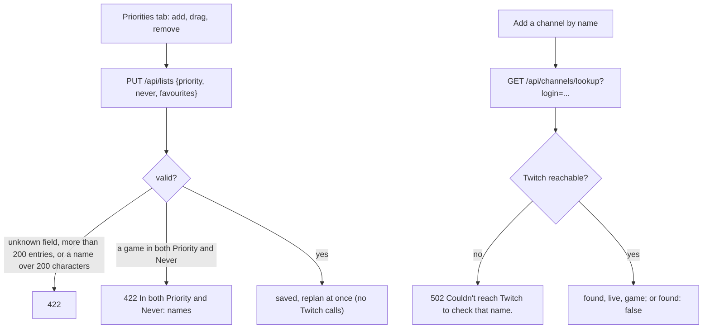

Divergence check: `put_lists` and `lookup_channel` in `src/dropwatch/api/app.py`, `ListsIn` in
`src/dropwatch/api/models.py`, `PrioritiesView` in `web/src/views/Priorities.tsx`. Add boxes suggest
nothing until 3 letters are typed (commit `22bae17`).

## 8. Channel points list

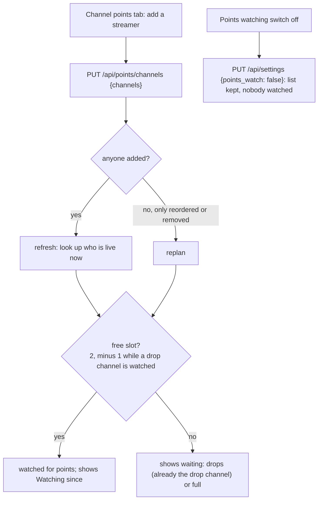

Divergence check: `put_points_channels` and `_points_page` in `src/dropwatch/api/app.py`,
`_choose_points` in `src/dropwatch/runner.py` (`POINTS_SLOTS = 2`).

## 9. Back up and restore settings

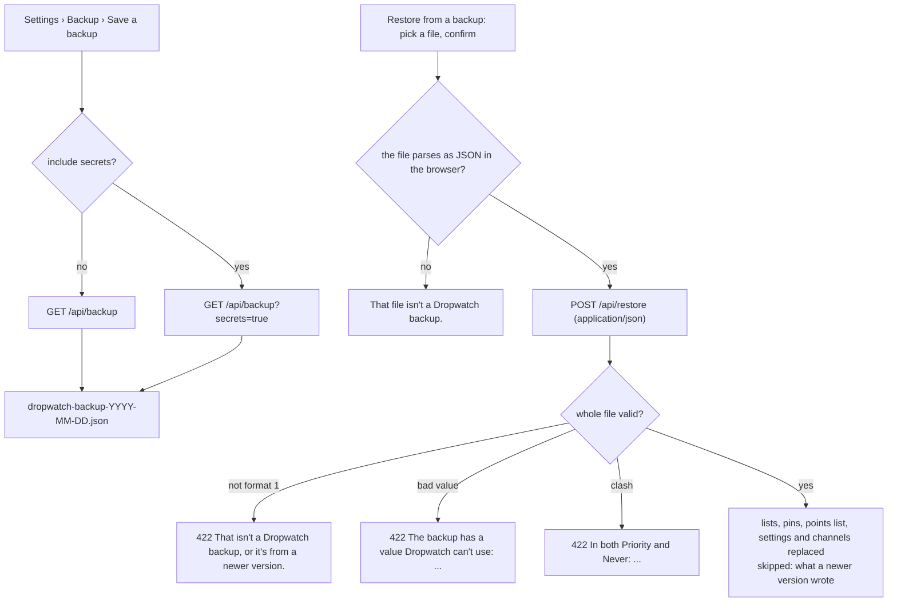

Divergence check: `make_backup` and `restore_backup` in `src/dropwatch/backup.py`, `post_restore` in
`src/dropwatch/api/app.py`, the Backup section of `web/src/views/Settings.tsx`.

## 10. Twitch session ends

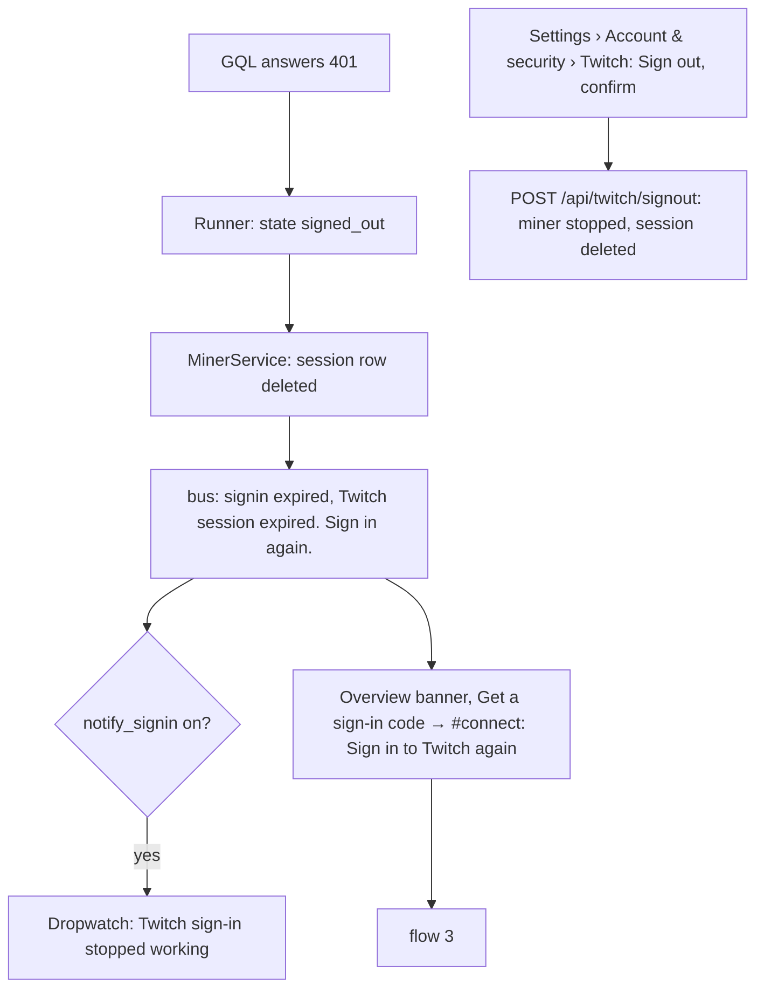

Divergence check: `MinerService._loop` in `src/dropwatch/service.py`, `signout` in
`src/dropwatch/api/app.py`, `Notifier.handle` in `src/dropwatch/alerts.py`. Drop progress is kept by Twitch,
not by Dropwatch, so it carries on after the next sign-in.

## 11. Updating

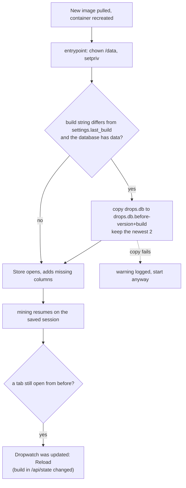

Divergence check: `backup_on_upgrade` and `safe_backup_on_upgrade` in `src/dropwatch/maintenance.py`
(`BACKUP_KEEP = 2`), `UpdateNotice` in `web/src/App.tsx`, the `build` field set in `get_state`
(`src/dropwatch/api/app.py`). Rolling back is by hand: see [updating.md](../guides/updating.md).
